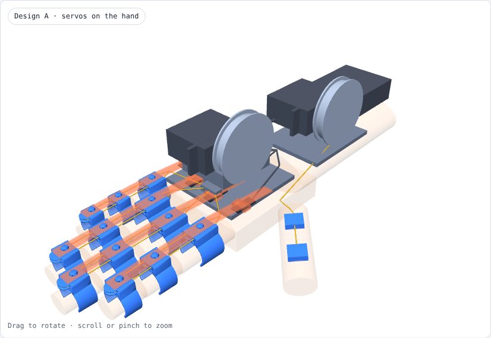

# MDDSTROKE: finger-extension exoskeleton for stroke patients

An NTU group project. A motor pulls a braided line along the back of each finger to open a hand stuck in a fist.
- **EMG** on the forearm detects the intent to open.
- A **flex sensor** stops the motor when the finger is straight.
- A **website** shows a live 3D hand.

| Start here | |
|---|---|
| 📋 What's done / what's next | [PROGRESS_FARID.md](PROGRESS_FARID.md) |
| ⚠️ Before testing on anyone | [SAFETY.md](SAFETY.md) |
| 🤖 Using Claude / Claude Code on this repo | [CLAUDE.md](CLAUDE.md) (Claude reads it automatically) |
| 🌐 Website v1 (working, low-poly hand) | [website/v1](website/v1) · how to use: [docs/website_v1_handoff.md](docs/website_v1_handoff.md) |
| 🌐 Website v2 (realistic hand, 5 fingers) | [website/v2](website/v2) · how to use: [website/v2/README.md](website/v2/README.md) · live: https://nattyboppy.github.io/MDDSTROKE/v2/ (after Pages is switched on) |
| 🔌 Arduino / ESP32 code | [firmware/](firmware) |
| 🖨️ 3D-printable parts | [hardware/stl/](hardware/stl) · **latest finger clamps: [hardware/stl/finger_clamps_v8](hardware/stl/finger_clamps_v8)** |
| 🧩 Interactive design pages (3D, open in Chrome) | [docs/design/finger_clamps.html](docs/design/finger_clamps.html) · [docs/design/hand_unit_layout.html](docs/design/hand_unit_layout.html) |
| 🖼️ Wiring diagrams + design concepts | [docs/wiring/](docs/wiring) · [docs/concepts/](docs/concepts) |

## How the system fits together

## Finger interface: TPU C-clamps v8
Three soft TPU clamps per finger (base, middle and tip segment). Each wraps about 70 % of the finger with the gap on the palm side, and is 3 mm bigger than the finger for a 1.5 mm foam liner.
- A **flat elastic strap** presses onto a stud on each clamp, like a watch strap, so the clamps stay linked and never dangle. No tools to put it on or take it off.
- The fishing line runs as a **U-loop**: up one side of the finger, round a small pulley nose on the tip clamp, back down the other side. It pulls the finger straight without twisting, and there's no knot at the fingertip.
- Each clamp has a **slot for the flex sensor**, just above the finger.

| On the hand | Strap demo |
|---|---|
|  |  |

Files, sizes, print settings and assembly: [hardware/stl/finger_clamps_v8/README.md](hardware/stl/finger_clamps_v8/README.md).

## Where the motors go
Two layouts for the 2 × MG996R were compared in [docs/design/hand_unit_layout.html](docs/design/hand_unit_layout.html).

| B · table-top unit (chosen for V1) | A · servos on the hand (portable option, later) |
|---|---|
|  |  |
| About 30–40 g on the hand. Servos, ESP32 and power in a box on the table. Lines reach the hand in coil sheaths. Sheaths lose about 20–40 % of the pull. | About 170–200 g on the hand, and the spool stands 36–51 mm high. The thumb servo has to sit over the wrist. |

**Watch out:** the MG996R datasheet gives only about 120° of rotation. To reel in about 47 mm of line (estimated, fist to straight), the spool needs a radius of about 22 mm. That leaves only about 6 N per finger in steady use when one servo pulls all 4 fingers. Measure the pull the test hand needs with a luggage scale before building the box.

## Team: how to edit
- Small change: open the file on GitHub → pencil icon → edit → **Commit changes**.
- Bigger change: open the repo in Claude Code and describe what you want. It reads `CLAUDE.md` first.
- After a work session, add a dated entry to `PROGRESS_FARID.md`.
