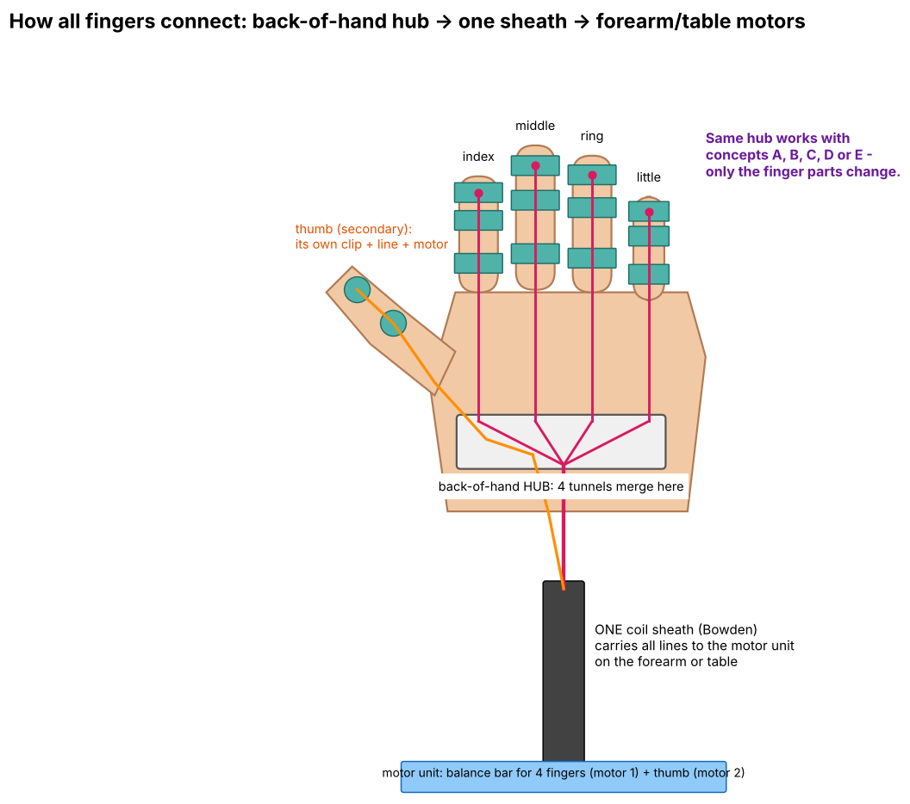

# MDDSTROKE: finger-extension exoskeleton for stroke patients

An NTU group project. A motor pulls a braided line along the back of each finger to open a hand stuck in a fist.
- **EMG** on the forearm detects the intent to open.
- A **flex sensor** stops the motor when the finger is straight.
- A **website** shows a live 3D hand.

| Start here | |
|---|---|
| 📋 What's done / what's next | [PROGRESS_FARID.md](PROGRESS_FARID.md) |
| ⚠️ Before testing on anyone | [SAFETY.md](SAFETY.md) |
| 🤖 Using Claude / Claude Code on this repo | [CLAUDE.md](CLAUDE.md) (Claude reads it automatically) |
| 🌐 Website v1 (working, low-poly hand) | [website/v1](website/v1) · how to use: [docs/website_v1_handoff.md](docs/website_v1_handoff.md) |
| 🌐 Website v2 (realistic hand, 5 fingers) | [website/v2](website/v2) · how to use: [website/v2/README.md](website/v2/README.md) · live: https://nattyboppy.github.io/MDDSTROKE/v2/ (after Pages is switched on) |
| 🔌 Arduino / ESP32 code | [firmware/](firmware) |
| 🖨️ 3D-printable parts | [hardware/stl/](hardware/stl) |
| 🖼️ Wiring diagrams + design concepts | [docs/wiring/](docs/wiring) · [docs/concepts/](docs/concepts) |

## How the system fits together

## Team: how to edit
- Small change: open the file on GitHub → pencil icon → edit → **Commit changes**.
- Bigger change: open the repo in Claude Code and describe what you want. It reads `CLAUDE.md` first.
- After a work session, add a dated entry to `PROGRESS_FARID.md`.
