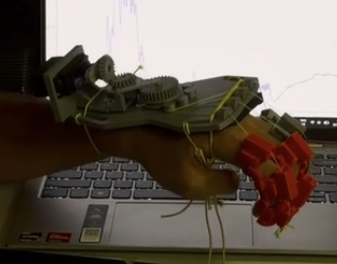

# MDDSTROKE: finger-extension exoskeleton for stroke patients

An NTU group project for stroke patients whose hand rests in a **clenched fist**.
When the patient **tries** to open the hand, a sensor on the forearm picks up the muscle signal, and a motor pulls the four fingers straight.

## How it works (29 Oct setup)
1. The patient tenses the **forearm muscles** (flexor / extensor).
2. **Electrodes** on the skin pass the signal to an **analog EMG sensor**, powered by **two 9 V batteries**.
3. An **Arduino Uno R3** reads the signal, smooths it, and checks it against a threshold.
4. On a "hit", the Uno turns the **MG996R servo**, which is screwed into the **back-of-palm holder**.
5. Through a **3-gear train** (servo gear → idler gear → big gear), the big gear's **spool** winds in a **nylon fishing line**.
6. The line goes taut and pulls the **index, middle, ring and little finger** straight, all at once. No thumb for now.
7. On the next hit the servo returns, the spool unwinds, the line goes slack, and the fingers curl back into a fist by themselves.
8. **Emergency stop** (designed 1 Nov, not built yet): a red button cuts the servo's power at once, so the patient can take the device off safely.

**Power:** the 2 × 9 V batteries power **only** the EMG sensor. The **laptop** (USB) powers the Uno, and the Uno powers the servo through the E-stop.

## Folders
| Folder | What is in it |
|---|---|
| [`wiring/`](wiring/) | system overview + breadboard wiring pictures, parts list, emergency stop |
| [`arduino_ide_code/`](arduino_ide_code/) | Arduino sketches: **29 Oct working code**, and the 1 Nov version with the E-stop |
| [`biomechanics_calculation/`](biomechanics_calculation/) | the finger force / spool / torque calculation (PDF) |
| [`design/`](design/) | prototype photo, **29 Oct back-of-palm holder (.3mf print file)**, `3d_printed/` finger casings |
| [`website/`](website/) | live 3D hand + **Serial plotter** (watch the EMG live in Chrome, like the Arduino IDE) |
| [`misc/`](misc/) | work log, safety checklist (`misc/docs/SAFETY.md`), earlier firmware / hardware / docs, the full `CLAUDE.md` |

## ⚠️ Before testing on a person
- Read [`misc/docs/SAFETY.md`](misc/docs/SAFETY.md).
- Laptop **charger unplugged** during EMG tests.
- First run the servo **without a hand** in the holder, and have someone ready to pull the USB cable (until the E-stop is built).
- The servo currently runs on USB power through the Uno. If the Uno resets or the servo twitches, give it its own 5–6 V supply (grounds joined). Details in [`arduino_ide_code/README.md`](arduino_ide_code/README.md).

## Planned next (to discuss with the team)

### A. Upgrade the Uno setup with parts we already have (added 2 Nov)
**Goal:** the EMG and motor data reach the laptop / website **live over Bluetooth** (no USB cable), and every session is **saved with its date and time** on a memory card. The professor wants a stored **history of the measurements**.

**Parts on hand:** HC-05 Bluetooth module · DS3231 real-time clock (with CR2032 coin battery) · microSD module (YwRobot) + 16 GB card · Adafruit 2.8" TFT touch shield (ILI9341 screen, FT6206 touch, its own microSD slot).

| What | What it's for | Status |
|---|---|---|
| **HC-05 Bluetooth** | live data to the laptop / website, no cable | 🔧 sketch `uno_emg_mg996r_hc05_2nov` (D10 / D11, see below); paired with a MacBook, website test to do |
| **microSD module** | saves every session as a file → history for the report | ⏳ to wire + code |
| **DS3231 clock** | puts the real **date and time** on every saved reading | ⏳ to wire + code |
| **2.8" TFT touch shield** | screen on the device (optional) | ⏸ parked for the ESP32-S3, see A4 |

**Uno pin plan.** A0, D9 and D2 are already taken and stay as they are.

| Uno pin | Used by |
|---|---|
| A0 | EMG sensor SIG (taken) |
| D9 | MG996R servo signal (taken) |
| D2 | E-stop sense, 10k to GND (taken, 1 Nov design). **Don't use D2 for Bluetooth.** |
| D1 (TX) | → **1kΩ** → HC-05 **RXD**, with **2kΩ** from RXD to GND (the HC-05 pins are 3.3 V, the Uno sends 5 V) |
| D0 (RX) | left free, so uploading code still works |
| A4 / A5 | DS3231 **SDA / SCL** |
| D10 / D11 / D12 / D13 | SD module **CS / MOSI / MISO / SCK** |
| 5V / GND | HC-05, DS3231, SD module (all grounds joined) |

1. **Bluetooth (HC-05) → live data on the laptop / website.**
   - The HC-05 is "classic" Bluetooth. Pair it once with the Windows laptop (PIN `1234` or `0000`); it then appears as an extra **COM port**.
   - The website's **Serial plotter** opens it like a USB port: USB speed **9600** (the HC-05's default), click **Connect by USB**, pick the Bluetooth COM port. No website change needed for a first test.
   - With the D1 wiring above, everything the sketch already prints goes out over USB **and** Bluetooth at the same time, so the first test needs **no code change**.
   - It's one-way (Uno → laptop). If the website should later send `o` / `c` / `s` over Bluetooth: HC-05 TXD → D7 with `SoftwareSerial`. The hardware E-stop stays the real stop either way.
   - **2 Nov sketch** [`arduino_ide_code/uno_emg_mg996r_hc05_2nov`](arduino_ide_code/uno_emg_mg996r_hc05_2nov/) uses `SoftwareSerial` instead: HC-05 TXD → **D10**, D11 → 1k → HC-05 RXD (2k to GND). This takes the SD module's CS / MOSI pins, so move the HC-05 (e.g. D7 / D8) before adding the SD card. On a Mac the HC-05 shows up as the port `cu.HC-05`.
   - Limits: an iPhone can't see an HC-05 at all, and Chrome's Web Bluetooth ("ExoHand") only works with the ESP32 (see B1).
2. **microSD → saved history of every session.**
   - One CSV file per session, named from the clock's date and time (8 characters max, e.g. `11051432.CSV` = 5 Nov, 14:32).
   - One line about every 0.1 s: date + time, EMG (smoothed), hand state (OPEN / CLOSED), number of openings so far, E-STOP yes/no.
   - A summary line at the end of each session: number of openings, peak EMG, session length.
   - Size: about 1 MB per hour, so 16 GB lasts for years. Format the card as **FAT32**. Open the files in Excel to make graphs for the report.
   - Wiring: as in the pin plan. **Check the module's label**: VCC on 5V if it says 5 V (or 3.3–5 V); on 3V3 if it says 3.3 V only.
3. **Real-time clock (DS3231) → real date and time on every reading.**
   - The Uno only counts milliseconds since switch-on and forgets everything on reset. The DS3231 keeps the date and time even when unplugged (coin battery).
   - Set it once from the laptop's clock with a small setup sketch, then it just runs.
   - Wiring: SDA → A4, SCL → A5, VCC → 5V, GND → GND.
4. **Screen (optional): parked for now.** The Adafruit 2.8" touch shield doesn't fit the current Uno setup:
   - as a shield it plugs over **every** Uno header, so nothing else can be wired;
   - its screen uses **D9 (the servo's pin)** and D10 (the SD module's CS);
   - screen + SD libraries together nearly fill the Uno's memory (32 KB program, 2 KB RAM).
   - Plan: use it on the **ESP32-S3** table unit (the "display on the table unit" already planned for later). It could show READY / OPEN / E-STOP, a live EMG bar, the session count and the time. Its own microSD slot could then replace the separate SD module.
5. **Power check after adding these.** The HC-05 (~40 mA), SD card writes (up to ~100 mA) and the clock all come from the Uno's 5V, which already feeds the MG996R from the laptop's USB. Servo spikes can then drop the 5 V: Bluetooth disconnects, SD files get corrupted, the Uno resets.
   - Give the servo **its own 5–6 V supply** (grounds joined; the E-stop then goes into that supply's + wire).
   - Add a **100 µF capacitor** across the HC-05's VCC and GND (stripe to GND).

**Suggested build order:** (1) HC-05 alone, check the plotter works over Bluetooth → (2) clock, print the time → (3) SD card, log one test session → (4) one combined sketch: E-stop + EMG + servo + clock + SD + Bluetooth.

### B. Still planned
1. **ESP32-S3 (later):** Wi-Fi, Web Bluetooth ("ExoHand", works on Android too), enough pins and memory for the screen and more sensors.
   - **Wi-Fi** is harder: a website on `https://` (GitHub Pages) can't talk to a plain `http://` ESP32 on the local network. Options: the ESP32 serves its own page, or a secure connection.
2. **EMG min / max thresholds.** Today the motor toggles on any contraction spike (above 400, relax below 250). We want a proper **minimum and maximum** per person (calibrate at rest and at full effort), to decide when the spool **tightens** (open) and when it **releases** (close). The SD history (A2) helps pick these numbers.
3. **Emergency stop: build it** (with the mechanics team). A switch or button that **stops everything** without breaking anything, so the patient can take the device off. Wiring, parts and code are ready in [`wiring/`](wiring/) and [`arduino_ide_code/uno_emg_mg996r_estop_1nov`](arduino_ide_code/uno_emg_mg996r_estop_1nov/). Mechanics: where it sits so the patient can reach it with the other hand.
4. **Website as the Arduino IDE.** ✅ Started: the website's **Serial plotter + monitor** shows the Uno's EMG live over USB (set USB speed to 9600). Next: the same over **Bluetooth** through the HC-05 (A1).
5. **Fully wireless (no USB cable at all):** Bluetooth (A1) takes care of the data. The Uno then also needs its own power (e.g. a USB power bank), and the servo its own supply (A5).

## Team: how to edit
- Small change: open the file on GitHub → pencil icon → edit → **Commit changes**.
- Bigger change: open the repo in Claude Code and describe what you want. It reads `CLAUDE.md` (which loads `misc/CLAUDE.md`) first.
- After a work session, add a dated entry to [`misc/PROGRESS_FARID.md`](misc/PROGRESS_FARID.md).
