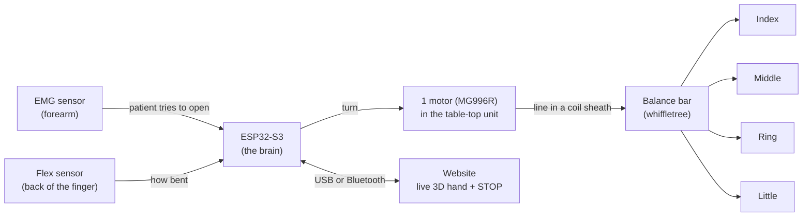
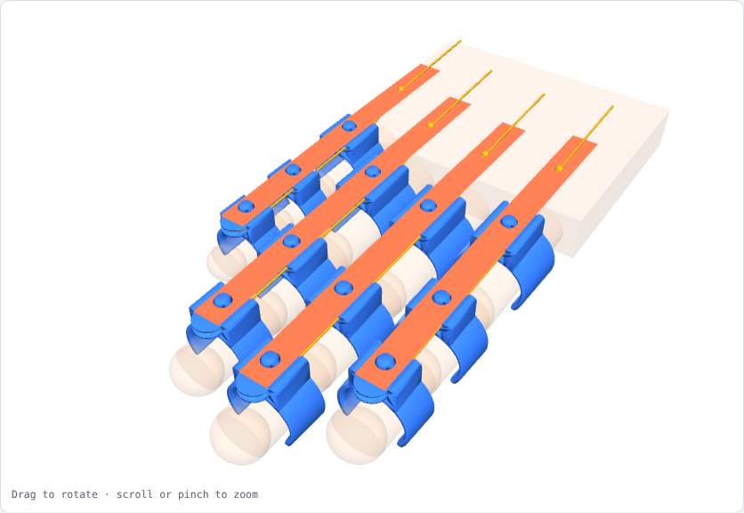
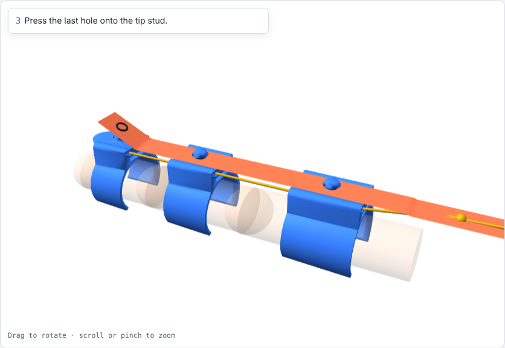
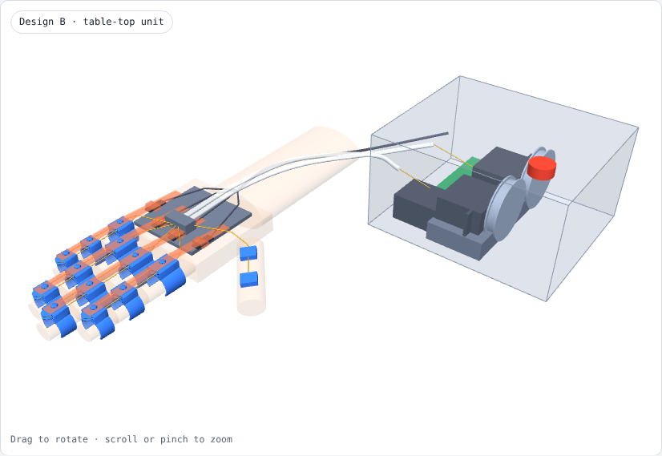

# MDDSTROKE: finger-extension exoskeleton for stroke patients

An NTU group project. One motor pulls a braided line along the back of the fingers to open a hand stuck in a fist.
- **EMG** on the forearm detects the intent to open.
- A **flex sensor** stops the motor when the finger is straight.
- A **website** shows a live 3D hand.

| Start here | |
|---|---|
| 🌐 Live hand tracker website | https://nattyboppy.github.io/MDDSTROKE/v2/ (works while the repo is **Public**) · how to use: [website/v2/README.md](website/v2/README.md) |
| ⚠️ Before testing on anyone | [docs/SAFETY.md](docs/SAFETY.md) |
| 🔌 Arduino / ESP32 code | [firmware/](firmware) |
| 🖨️ 3D-printable parts (by date) | [hardware/](hardware) · **latest finger clamps: [hardware/2026-10-23/finger_clamps_v8](hardware/2026-10-23/finger_clamps_v8)** |
| 🧩 Interactive design pages (3D, open in Chrome) | [docs/design/finger_clamps.html](docs/design/finger_clamps.html) · [docs/design/hand_unit_layout.html](docs/design/hand_unit_layout.html) |
| 📋 Work log (what was done / what's next) | [misc/PROGRESS_FARID.md](misc/PROGRESS_FARID.md) |
| 🗄️ Old wiring, concepts, notes | [docs/old/](docs/old) |

## How the system fits together
**One motor, four fingers, no thumb (for now).**

1. The patient **tries** to open the hand. The **EMG** sensor on the forearm picks this up.
2. The **ESP32** turns the **motor**, which reels in the line.
3. The line runs inside a coil sheath to the hand, where a **balance bar** shares the pull between the **4 fingers**.
4. When the **flex sensor** says the finger is straight, the ESP32 **stops** the motor.
5. The **website** shows the hand live, and its big **STOP** button always works.

## Folders
| Folder | What is in it |
|---|---|
| `website/v2/` | the live hand tracker website |
| `firmware/` | Arduino / ESP32 sketches: `flex/`, `emg/`, `motors/` |
| `hardware/<date>/` | 3D parts and the scripts that make them, grouped by the date they were added. Put new parts in a new date folder (`YYYY-MM-DD`). |
| `docs/` | `SAFETY.md`, design pages, previews, screenshots, and `old/` |
| `misc/` | the work log |
| `CLAUDE.md` | instructions that Claude Code reads automatically. It has to stay in the top folder. |

## Finger interface: TPU C-clamps v8
Three soft TPU clamps per finger (base, middle and tip segment). Each wraps about 70 % of the finger with the gap on the palm side, and is 3 mm bigger than the finger for a 1.5 mm foam liner.
- A **flat elastic strap** presses onto a stud on each clamp, like a watch strap, so the clamps stay linked and never dangle. No tools to put it on or take it off.
- The fishing line runs as a **U-loop**: up one side of the finger, round a small pulley nose on the tip clamp, back down the other side. It pulls the finger straight without twisting, and there's no knot at the fingertip.
- Each clamp has a **slot for the flex sensor**, just above the finger.

| On the hand | Strap demo |
|---|---|
|  |  |

Files, sizes, print settings and assembly: [hardware/2026-10-23/finger_clamps_v8/README.md](hardware/2026-10-23/finger_clamps_v8/README.md).

## Where the motor goes
The motor sits in a **table-top unit** (layout B in [docs/design/hand_unit_layout.html](docs/design/hand_unit_layout.html)). Only about 30–40 g ends up on the hand. The line reaches the hand in a coil sheath, which loses about 20–40 % of the pull.

*(This picture was drawn when a second motor for the thumb was planned. For now there is only the one 4-finger motor.)*

**Watch out:** the MG996R datasheet gives only about 120° of rotation. To reel in about 47 mm of line (estimated, fist to straight), the spool needs a radius of about 22 mm. That leaves only about 6 N per finger in steady use when one servo pulls all 4 fingers. Measure the pull the test hand needs with a luggage scale before building the box.

## Team: how to edit
- Small change: open the file on GitHub → pencil icon → edit → **Commit changes**.
- Bigger change: open the repo in Claude Code and describe what you want. It reads `CLAUDE.md` first.
- After a work session, add a dated entry to `misc/PROGRESS_FARID.md`.
