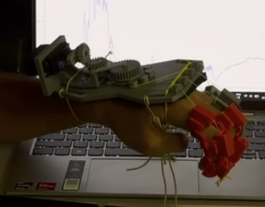
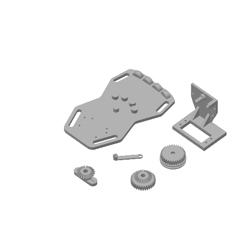

# Design

## Current prototype (29 Oct): hand holder + 4 finger casings

- **Finger casings** on the index, middle, ring and little finger. No thumb for now.
- **Hand holder** on the back of the hand and forearm. The **MG996R** servo is screwed in at its base.
- **3-gear train:** the servo turns the **servo gear** → the **idler gear** (middle) → the **big gear**. The big gear carries the **spool**.
- **Spool** winds and unwinds the **nylon fishing line**, which runs to all 4 finger casings, so one motor pulls all 4 fingers at once.
- Servo turns → spool **winds** (clockwise) → line goes **taut** → fingers **straighten**.
- Servo returns → spool **unwinds** → line goes **slack** → the fingers curl back into a **fist** by themselves (the stroke patient's resting tone).

## 29 Oct back-of-palm device holder (print file)
[`29oct_back_of_palm_device_holder.3mf`](29oct_back_of_palm_device_holder.3mf): one print plate with all the holder parts. Open it in **Bambu Studio** (or another slicer that reads .3mf).

| Part (name in the file) | What it does |
|---|---|
| Base hand 2 | the plate on the back of the palm, with strap slots |
| Servo Holder | the bracket the MG996R is screwed into |
| Servo Gear | the small gear on the servo |
| Idler Gear | the middle gear |
| spool .2 | the big gear with the spool that winds the fishing line |
| Spool Clip | holds the spool in place |

## Folders and files
| | |
|---|---|
| [`3d_printed/`](3d_printed/) | STL files of the current printed parts |
| [`finger_clamps.html`](finger_clamps.html) | interactive 3D page of the earlier TPU C-clamp design (v8). Download it, then double-click it to open in Chrome |
| [`hand_unit_layout.html`](hand_unit_layout.html) | interactive comparison of motor layouts (made when 2 motors were planned) |

Older printed parts (spools, knuckle set, C-clamps v8) are in [`../misc/hardware/`](../misc/hardware/), grouped by date.
