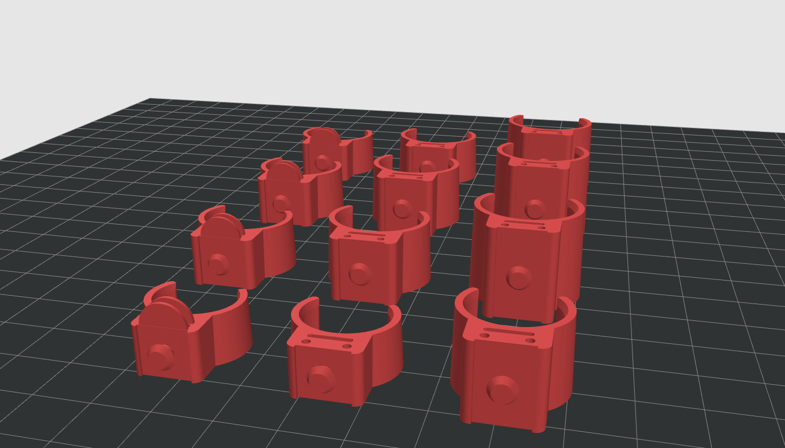

# Finger C-clamps v8 (TPU)

Three soft C-clamps per finger, one on each segment. Each one wraps about **70 %** of the finger, with the gap on the palm side, so it snaps on.
The tip of the finger is left open.

Interactive 3D preview, strap demo and assembly steps: open [`design/finger_clamps.html`](../../../../design/finger_clamps.html) in Chrome (download the file, then double-click it).

## What each clamp has
| Feature | Size | What it's for |
|---|---|---|
| C-shell | 1.8 mm wall, 70 % wrap | Holds the finger. Inner size = finger + 3 mm, leaving room for a **1.5 mm foam liner** all round |
| Press stud on top | head Ø4.6, neck Ø3.0 | The elastic strap pops over it like a watch strap. Keeps the clamps linked so they never dangle |
| Shallow recess on top | 8.8 mm wide | Keeps the 8 mm elastic lined up |
| Two line channels | Ø1.4 mm, 3.2 mm either side of centre | The two legs of the **U-loop** fishing line (up one side of the finger, round the tip, back down) |
| Flex sensor slot | 7.2 × 1.0 mm, just above the finger | The flex sensor slides through it (fix only the pin end on the back of the hand) |
| Tip clamp only: pulley nose | core R2.5, rims R4.1 | The line turns 180° round it. No knot at the fingertip |

## Files
- `<finger>_1_base_v8.stl`, `<finger>_2_middle_v8.stl`, `<finger>_3_tip_v8.stl` for index, middle, ring and pinky (12 parts).
- `ALL_12_print_plate_v8.stl`: all 12 laid out on one plate.
- `sizes.json`: every size, made by the script.
- Made by [`cad_scripts/make_finger_clamps.py`](../cad_scripts/make_finger_clamps.py). To resize, change `FINGERS` at the top and run it again. If you change the shape, bump `VERSION` so the file names change.

**Only print files ending in `_v8`.** Older files (with a rectangular tunnel and a pin hole off to one side) are out of date.

## Sizes (mm)
Finger widths were measured with calipers on a team member's hand. Segment lengths are still average adult values.

| Finger | Finger width base / mid / tip | Inner width (+3 mm foam) | Clamp length | Strap hole spacing | Elastic to cut |
|---|---|---|---|---|---|
| Middle | 15.0 / 14.6 / 14.2 | 18.0 / 17.6 / 17.2 | 18.4 / 13.5 / 10.8 | 38.0 / 27.0 | 111 |
| Ring | 14.9 / 14.4 / 13.8 | 17.9 / 17.4 / 16.8 | 17.6 / 12.6 / 10.3 | 36.0 / 25.5 | 108 |
| Index | 16.1 / 15.2 / 14.2 | 19.1 / 18.2 / 17.2 | 16.8 / 11.2 / 9.9 | 33.5 / 23.5 | 103 |
| Pinky | 12.5 / 12.0 / 11.5 | 15.5 / 15.0 / 14.5 | 13.6 / 9.0 / 9.0 | 27.0 / 20.0 | 93 |

The middle-segment width is the average of base and tip. All 12 clamps together use about 17.5 cm³ of TPU (about 21 g).

## Print settings
| Setting | Value |
|---|---|
| Material | TPU 95A (the school's filament) |
| Orientation | Stand each clamp on its wider (knuckle-side) end, as in the STL. No supports |
| Layer height | 0.2 mm |
| Walls | 4 (the wall is solid) |
| Speed | 20–25 mm/s |
| Bed adhesion | Brim for the pinky parts |

## Parts to buy
- 8 mm flat elastic (about 0.5 m for all 4 fingers) and a 3 mm leather hole punch.
- Braided fishing line: we use PE 4.0 (0.32 mm, 42 lb). The 1.4 mm channels give it plenty of room.
- 1.5 mm foam sheet for the liner.

## Assembly (one finger)
1. **Cut and punch the elastic.** Cut it to the length in the table. Punch three 3 mm holes: the first 40 mm from the knuckle end, then the next two at the hole spacing. If it's polyester, pass a lighter flame quickly over each hole so it doesn't fray.
2. **Fit the clamps.** Line each one with foam and snap it on from the palm side, in the middle of its segment.
3. **Thread the fishing line.** Put a dab of superglue on the last 1 cm and let it dry so the end is stiff. From the knuckle end, go up the left channels of all three clamps, round the groove on the tip clamp's nose, then back down the right channels.
4. **Join the two ends** about 20 mm behind the base clamp, onto the single line that goes to the balance bar (whiffletree). Use a Palomar or uni knot plus a drop of superglue, because braided line is slippery. Pull gently with the finger straight: the line should slide round the nose so both sides go equally tight.
5. **Slide in the flex sensor**, pins towards the hand, through the base and middle clamps. Fix only the pin end on the back-of-hand plate.
6. **Press the strap on**, base stud first, then middle, then tip. To take it off, peel from the fingertip end.

## Check on the first test print
- Strap too stiff to press on → punch 3.5 mm holes. Strap pops off when the hand closes → punch 2.5 mm holes, or make the stud head bigger in the script.
- Clamp too tight or too loose → change the width in `FINGERS` by 0.5 mm and run the script again.
- After a few sessions, check whether the line is cutting a groove into the TPU at the tip nose.
- Check the skin for red marks after 15 minutes of wear (see [SAFETY.md](../../../docs/SAFETY.md)).
