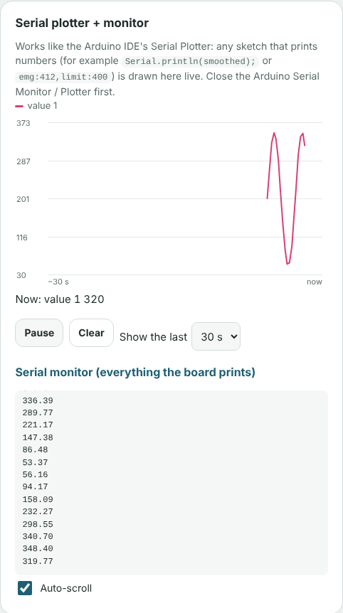

# Website

The **live hand tracker**: a realistic 3D hand that copies the real fingers, with a big STOP button. It runs in Chrome; no install needed.

- Live link: **https://nattyboppy.github.io/MDDSTROKE/v2/** (only works while the GitHub repo is **Public**)
- Try it without any hardware: open the link and press **Demo (no hardware)**.

| In this folder | |
|---|---|
| [`v2/`](v2/) | the website itself. **How to use it: [v2/README.md](v2/README.md)** |
| [`index.html`](index.html) | the front door: it just forwards visitors to `v2/` |
| [`screenshots/`](screenshots/) | pictures of the website (made by the automatic test) |
| [`v2_build_prompt.md`](v2_build_prompt.md) | the original instructions the website was built from |

## Use it with the 29 Oct Uno now: the Serial plotter
The website has a **Serial plotter + monitor** that works like the Arduino IDE's, so you can watch the EMG live in Chrome:
1. Upload the 29 Oct code to the Uno, and **close** the Arduino IDE's Serial Monitor / Plotter.
2. Open the website in **Chrome**. Under **1 · Connect**, set **USB speed** to **9600 (Uno 29 Oct EMG code)**.
3. Click **Connect by USB** and pick the Uno's port.
4. The **Serial plotter** panel draws the smoothed EMG live. **Pause**, **Clear** and **Show the last 10 / 30 / 60 s** work like you'd expect.

The **3D hand** only moves with ExoHand data lines (`D`, `F`, `M`, `E`), which the ESP32 sketches send. The Uno code prints plain numbers, so it shows up in the plotter only.
Wireless (Bluetooth / Wi-Fi) needs the ESP32-S3; see "Planned next" in the main README.

GitHub publishes this folder automatically every time something changes in it on `main` (see `.github/workflows/pages.yml`).
