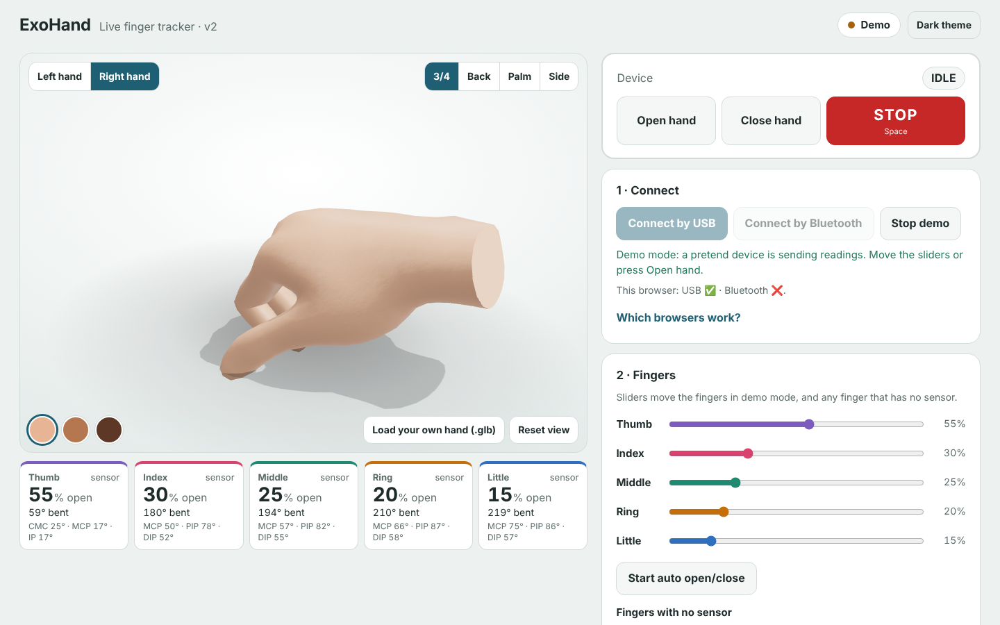

# Website v2: realistic live hand

A dashboard that shows a **realistic 3D hand** copying the real fingers, live, from the flex sensors on the exoskeleton.
It works over **USB** or **Bluetooth**, and has a **Demo** mode that needs no hardware.

- Online (after GitHub Pages is switched on, see below): **https://nattyboppy.github.io/MDDSTROKE/v2/**
- The link only works while the GitHub repo is **Public** (free GitHub accounts can't publish Pages from a private repo).



---

## Use it with the real sensors: step by step

### 1. Flash the firmware (once)
1. Open the Arduino IDE.
2. Open **`misc/firmware/flex/multi_flex_devkit/multi_flex_devkit.ino`** (5 fingers, USB + Bluetooth).
   *Only one sensor on GPIO 4? `misc/firmware/flex/flex_devkit_test` also works (it sends the older `D,` lines).*
3. In `multi_flex_devkit`, find the box `WHICH SENSORS ARE CONNECTED?` and set `true` for each finger that has a sensor.
   The order is thumb, index, middle, ring, little. Start with only the index: `{ false, true, false, false, false }`.
4. **Tools** menu:
   - Board: **ESP32S3 Dev Module**
   - USB CDC On Boot: **Disabled**
   - Flash Size: **16MB**
   - PSRAM: **OPI PSRAM**
5. Plug the USB-C cable into the DevKit port labelled **USB-UART** (or **COM**).
6. Pick the port under **Tools → Port**, then press the **→ Upload** arrow.

Wiring for each sensor (3.3 V only, **never 5 V**): `3V3 → flex sensor → GPIO pin → 47k resistor → GND`.
Picture: [misc/docs/old/wiring/flex_sensor_wiring.png](../../misc/docs/old/wiring/flex_sensor_wiring.png)
Pins: index **4**, middle **6**, ring **7**, little **8**, thumb **9**.

### 2. Close the Arduino Serial Monitor
Only one program can use the USB port at a time. If the Serial Monitor (or Serial Plotter) window is open, **close it**.
Otherwise the website will say "That port is busy".

### 3. Open the site in Chrome
Use **Chrome or Edge on a laptop**. Open the GitHub Pages link above.

| Browser | USB | Bluetooth |
|---|---|---|
| Chrome / Edge on a laptop | ✅ | ✅ |
| Chrome on Android | ❌ | ✅ |
| iPhone / iPad (any browser) | ❌ | ❌ (demo only) |
| Safari, Firefox | ❌ | ❌ (demo only) |

### 4. Connect by USB
1. Press **Connect by USB**.
2. A pop-up lists the ports. Pick the board (often **"USB-SERIAL CH343"**, **"CP210x"** or **"USB JTAG/serial"**), then press **Connect**.
3. The pill at the top turns green: **Connected by USB**. Bend a sensor and the finger moves.

*Uno with an HC-05 Bluetooth module instead:* press **Connect HC-05 (Bluetooth)** and pick **HC-05**. See [`../README.md`](../README.md) (section "Without the cable").

*Bluetooth instead:* press **Connect by Bluetooth** and pick **ExoHand**.

### 5. Calibrate
1. Hold the fingers **straight** and press **Save straight (all)**.
2. Make a **full fist** and press **Save fully bent (all)**.
3. Done. The numbers are saved in this browser. Use the small **Straight / Bent** buttons in the table to redo one finger.
4. **Export (.json)** saves the calibration as a file. Use **Import (.json)** to load it on another laptop.

Until you calibrate, the site guesses from the lowest and highest readings it has seen.
Our wiring makes the reading go **down** when the finger bends. If yours goes up, tick **"My sensors read higher when bent"**.

---

## The buttons
| Button | What it does |
|---|---|
| **STOP** (red), or the **Space** key | sends `s`. Always there. On a phone it sticks to the bottom of the screen. |
| **Open hand / Close hand** | send `o` / `c`. The firmware decides how far the motor goes. |
| **Demo (no hardware)** | a pretend device. Move the sliders, or press **Start auto open/close**. |
| **Fingers with no sensor** | choose: they **copy the index finger**, or follow **their slider**. |
| **Left / Right hand**, **3/4 · Back · Palm · Side**, **Reset view** | change the 3D view. Drag to turn the hand, scroll or pinch to zoom. |
| Skin circles | three skin tones. |
| **Load your own hand (.glb)** | try a different rigged hand model. The bones need names with thumb / index / middle / ring / pinky (or little). If the fingers bend backwards, tick **Bend the other way**. |
| **USB speed** | must match `Serial.begin(...)` in the sketch: **115200** for the ExoHand ESP32 sketches, **9600** for the 29 Oct Uno EMG code. |
| **Serial plotter + monitor** | like the Arduino IDE: any sketch that prints numbers (`412.5` or `emg:412,limit:400`) is drawn live. The monitor shows every line. |
| **Start recording → Download CSV** | saves time, raw readings, % open, degrees, servo angles and EMG (20 rows a second). |

**Safety:** the website only ever sends `o`, `c` or `s`. It never sends angles. The motor limits live in the firmware (`SAFE_MIN` / `SAFE_MAX` at the top of each sketch).
If the device reports **BLOCKED**, a red banner says "finger resisting: motor stopped".

---

## Turn on GitHub Pages (once)
1. On GitHub, open the repo and click **Settings** (top right of the repo page).
2. In the left menu, click **Pages**.
3. Under **Build and deployment → Source**, choose **GitHub Actions**.
4. Click the **Actions** tab. The workflow **"Publish website to GitHub Pages"** runs on every push to `main`.
   If nothing has run yet, click it, then click **Run workflow**.
5. After about 1 minute, the site is live at **https://nattyboppy.github.io/MDDSTROKE/**.

---

## For teammates who edit the code
No build step. Plain HTML, CSS and JavaScript modules. three.js 0.160.0 comes from the jsDelivr CDN.

| File | What is in it |
|---|---|
| `index.html` | the page layout |
| `css/style.css` | **all colours are CSS variables at the top** (light + dark theme) |
| `js/main.js` | joins everything together |
| `js/hand.js` | loads the hand, finds the bones, bends the fingers. **Tune the fist angles in `FIST_ANGLES`** |
| `js/protocol.js` | reads the `D, F, M, E` lines from the device. Ignores anything else |
| `js/serial.js` / `js/ble.js` | USB and Bluetooth |
| `js/calibration.js` | straight / bent numbers per finger |
| `js/charts.js` | the 30-second charts |
| `js/demo.js` | the pretend device |
| `assets/models/` | the MIT-licensed WebXR hand models (left + right) |

To try it on your own laptop, run this in the `website` folder and open http://localhost:8000/v2/
(double-clicking `index.html` does not work, because browsers block loading the 3D model from a file):
```
python -m http.server 8000
```

Tests:
```
node website/v2/tests/protocol.test.mjs      # protocol parser (no install needed)
node website/v2/tests/demo.e2e.mjs           # browser test in demo mode (needs Playwright)
```
