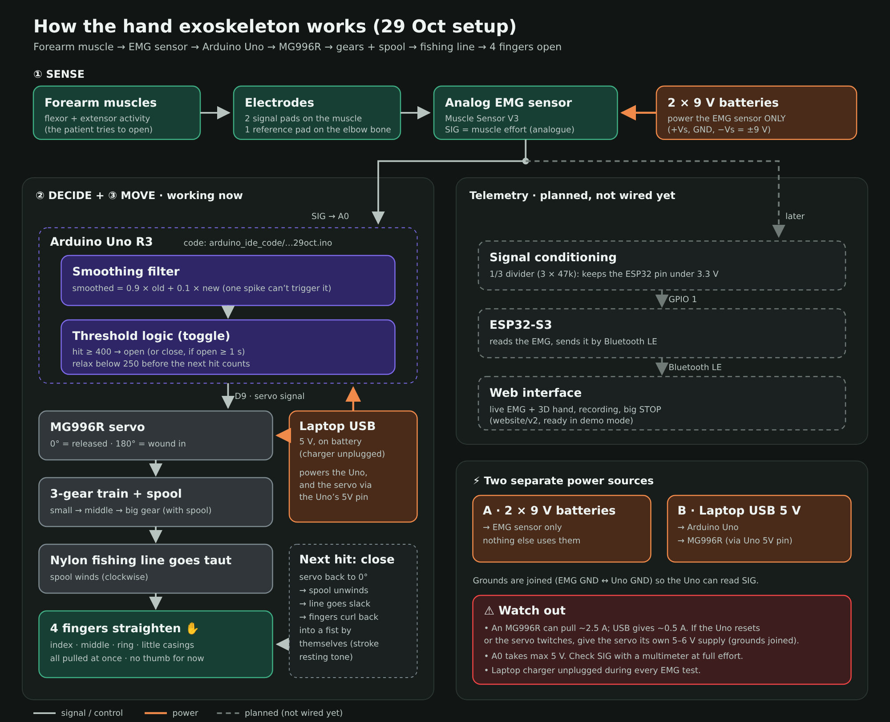
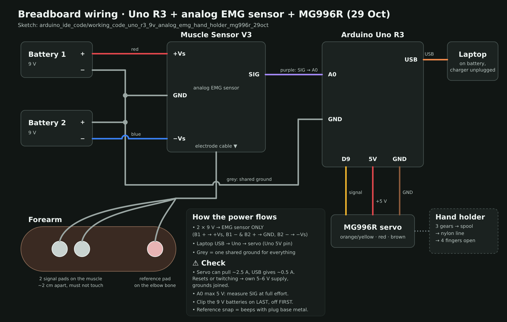

# Wiring

Current setup (29 Oct): **Arduino Uno R3 + analog EMG sensor (2 × 9 V) + MG996R + hand holder.**
The ESP32-S3 and the website are planned and drawn dashed; they're not wired yet.

| Picture | What it shows |
|---|---|
| [system_overview.png](system_overview.png) | the whole system, step by step: muscle → electrodes → EMG sensor → Uno → servo → gears + spool → line → 4 fingers, plus the two power sources |
| [breadboard_wiring.png](breadboard_wiring.png) | every wire: batteries → EMG sensor, SIG → A0, shared ground, D9 / 5V / GND → servo, laptop USB |

## Power, in one sentence each
- The **two 9 V batteries** power the EMG sensor and nothing else.
- The **laptop** (USB) powers the Uno, and the Uno's 5V pin powers the servo.
- All the grounds are joined, so the Uno can read the EMG signal.

## Editing the pictures
The pictures are made from the files in [`source/`](source/). Open one in Chrome to see it, and edit the text in it with any text editor.
To make a new PNG, take a screenshot of it, or ask Claude Code to re-render it.

Older wiring diagrams (ESP32 flex sensor, first EMG tests) are in [`../docs/old/wiring/`](../docs/old/wiring/).
